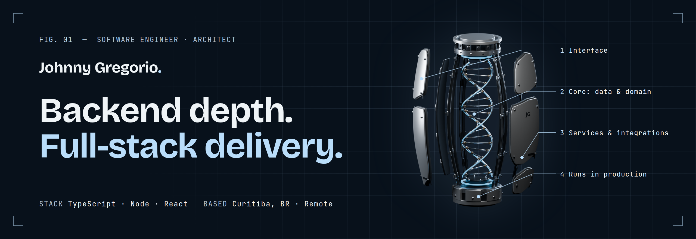

  
  
  
  

---

### `01` &nbsp;Now

**Software Architect & Tech Lead** at [ArchOffice](https://archoffice.tech), consulting for several clients in parallel across health, energy and payments.

- Modernizing legacy platforms into **cloud-native** systems: microservices, DDD, event-driven design, BFFs and identity/MFA migrations.
- Stabilizing and evolving production platforms: data-model normalization, Kubernetes, observability, secrets management.
- Leading the team's adoption of **AI-assisted development** (Claude Code, Anthropic SDK, custom agents and MCP tooling).
- Writing ADRs, architecture diagrams and onboarding guides, and mentoring developers along the way.

Hands-on is still the center of the job: backend first, full-stack when the product needs it.

### `02` &nbsp;Selected work

| Project | What it is | Stack |
|---|---|---|
| [**Arapé Records**](https://johnnygregorio.tech/projects/arape-records/) | My independent record label, plus the internal tools that run it: artist and release publishing, demo review, and a social-artwork tool that keeps the team on one visual direction. *Live.* | Next.js · NestJS · PostgreSQL |
| [**Cumpri**](https://cumpri.app) | Group challenges with a deadline: invites by link, daily check-ins, streaks and rankings. Landing page, PWA and API in one monorepo. | Astro · React PWA · Fastify · Drizzle |
| [**RapTrak**](https://johnnygregorio.tech/projects/raptrak/) | Find the next rap battle and build the scene around it: discovery, crew management, MC profiles and moderation. *Functional, not yet released.* | React Native · Express · TypeORM |

### `03` &nbsp;Toolbox

   
  

**Architecture** — DDD · microservices · event-driven · BFF / API gateway · legacy modernization (strangler) · ADRs 
**Identity & security** — OAuth 2.0 / OIDC · Keycloak · Azure AD B2C / External ID · MFA · PCI-DSS 
**Messaging** — RabbitMQ · AWS SQS · Airflow · webhooks 
**AI** — Claude Code · Anthropic SDK · agents & MCP

### `04` &nbsp;🇧🇷 Para empresas no Brasil

Atendo pequenas e médias empresas de forma remota, e você fala direto com quem constrói, do escopo à manutenção.

- **[Sites e landing pages](https://johnnygregorio.tech/pt/services/websites/)**: design responsivo, SEO técnico, performance e integrações.
- **[Sistemas sob medida e MVPs](https://johnnygregorio.tech/pt/services/products/)**: descoberta, frontend, backend e evolução contínua.
- **[SEO, Google Ads e mensuração](https://johnnygregorio.tech/pt/services/growth/)**: campanhas, analytics, pixels, conversões e AEO.

### `05` &nbsp;Off the clock

- 🧬 Studying **Biomedicine**; science is where a lot of my curiosity goes.
- 🎙️ Running a record label and spending time around Brazil's rap battle scene.
- 🎨 Fine-arts background, which is why I care about how things look as much as how they work.
- ✈️ I learned to fly a plane before I learned to drive a car.

Curitiba, BR · Remote · EN / PT

