  
  
  
  

> **Software Architect & Tech Lead at [ArchOffice](https://archoffice.tech).** I take legacy platforms to cloud-native (microservices, DDD, event-driven design, identity and MFA), keep production systems stable as they grow, and lead the team's adoption of AI-assisted development. Hands-on is still the center of the job: backend first, full-stack when the product needs it.

&nbsp;&nbsp;

<b>🇧🇷 Para empresas no Brasil</b>: sites, sistemas sob medida, SEO e Google Ads

 

Atendo pequenas e médias empresas de forma remota, e você fala direto com quem constrói, do escopo à manutenção.

- **[Sites e landing pages](https://johnnygregorio.tech/pt/services/websites/)**: design responsivo, SEO técnico, performance e integrações.
- **[Sistemas sob medida e MVPs](https://johnnygregorio.tech/pt/services/products/)**: descoberta, frontend, backend e evolução contínua.
- **[SEO, Google Ads e mensuração](https://johnnygregorio.tech/pt/services/growth/)**: campanhas, analytics, pixels, conversões e AEO.

